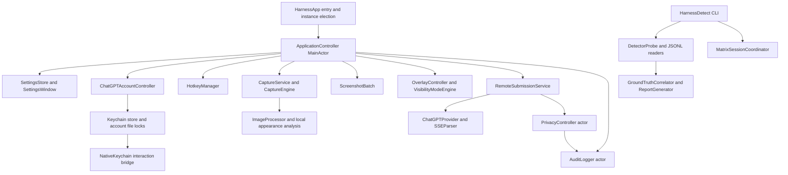

# Harness 0.6.1 architecture and ownership

This document describes implementation revision `6034926`, rather than proposing a replacement architecture. [SPEC.md](SPEC.md) fixes behavior and thresholds; [PROTOCOLS.md](PROTOCOLS.md) fixes serialization; the standalone platform builders define reconstruction order. Application code is unchanged by this documentation rewrite.

## 1. Components and dependency direction

SwiftPM produces two executables: `harness` (`HarnessApp`) and `harness-detect` (`HarnessDetect`). Shared internal targets are HarnessCore, HarnessEmitter, HarnessDetector and the small C NativeKeychain bridge. Only KeychainAccess 4.2.2 is an external Swift package. Framework services remain behind focused adapters; the detector does not import the GUI to automate it.



| Boundary | Production responsibility | Content/ownership consequence |
| --- | --- | --- |
| `HarnessApp/main.swift` | NSApplication lifecycle, oldest same-bundle instance election, explicit generated-image account diagnostic | Duplicate instance exits before creating account/window/hotkey owners |
| `HarnessEmitter/Application` | App task/generation ownership, readiness, settings transactions, saved presentation and lifecycle cleanup | Only one user acquisition/submission workflow; late results cannot publish after clear |
| `HarnessCore/Settings` | Typed defaults, field validation, migration, explicit preference domain, durable save/rollback | UI drafts and committed settings are distinct |
| `HarnessEmitter/Settings` | Status/onboarding/Advanced UI, selectors/drafts/busy sets | No screenshot just because the window loads or refreshes metadata |
| `HarnessEmitter/Account` | OAuth, loopback callback, JWT/JWKS, protected records, token refresh/revocation | Issued-client identity is separate from email; whole rotating token sets persist atomically |
| `NativeKeychain` | Public legacy interaction-policy bridge | Quiet reads suppress modern and legacy authorization UI together |
| `HarnessEmitter/Input` | Native Carbon registration, callback generations, held-key/release tracking | Physical shortcut admission, no function-key dependency or continuous event tap |
| `HarnessEmitter/Capture` | Scope plans/backends, native callback gates, original-image processing, screenshot queue | Exact scope; queue stores compressed/redacted results only |
| `HarnessEmitter/Presentation` | Pane/coordinate analysis, dominant background, installed-font estimate, literal renderer, panel, experimental modes | Saved metadata has no original pixels/OCR strings; three complete rows |
| `HarnessEmitter/Providers` | Inference adapter and Responses lifecycle/SSE parser | Internal streaming never directly paints partial text |
| `HarnessCore/Privacy` | Consent, one audited image operation, response-only history, scoped cleanup | Remote transmission cannot start before the durable metadata gate |
| `HarnessCore/Audit` | Strict event schema, ordered logger, protected append/report output and bounded locks | Mandatory failure latch; no content in logs |
| `HarnessCore/Research` | Calibration geometry/truth, environment metadata, CLI options and matrix receipts | Explicit provenance and configuration settling |
| `HarnessDetector` | Metadata enumeration, strict detection schema, bounded JSONL, correlation/report | No pixel capture or app control; absence is not inferred invisibility |
| `HarnessDetect` | scan/matrix/correlate shell entry and interactive coordination | User changes native mode/scope and presses the next physical key |
| `Tests`, `fixtures`, `Resources`, `scripts` | Synthetic/native regression fixtures, controlled page, licensed resources, identity-preserving release | Build/runtime data remain outside tracked source |

The complete per-file inventory is in [MACOS_BUILDER.md](MACOS_BUILDER.md). Do not add parallel implementations of settings/queue/response validation just because Windows has different adapters; reproduce common contracts with platform-local native boundaries.

## 2. Threading and task ownership

The UI controller, account controller, settings store/window, hotkey manager, capture acquisition coordinators, screenshot batch and overlay are main-actor owners. Privacy and audit each serialize their own state as actors. JPEG/masking, pane/color and typography work run on detached workers; AppKit windows/font resolution remain on the main actor. Provider state shared with the streaming worker is guarded by a small NSLock/RequestControl boundary; account store/file-lock and native callback state have their own synchronization.

The app retains separate task references for launch, physical operation, authentication, model/window refresh, permission, Save, position switching, calibration and queue expiration. A task slot is reserved before its first await. A control-specific busy state is released by that task's cleanup; unrelated control readiness does not grant another operation permission. Setting `ready=true` is insufficient if blocked, terminating, account-disconnecting or settings-applying is still active.

Cancellation is a request to cooperate, not proof native APIs have stopped. Every returned result must still pass identity/generation/consent checks. Structured child ownership is used where available; unstructured native-callback/HTTP tasks have explicit cancellation gates and late-result suppression. Detached image work checks cancellation in loops. Keeping a stale task reference or releasing a shared gate from the wrong operation can admit overlap, so cleanup must remain associated with its owner.

### Generation roles

| Generation/identity | Rejects |
| --- | --- |
| Settings revision | A Save/position change resuming after a newer save/disconnect |
| Authentication generation | Old sign-in/model results after account change/disconnect |
| Presentation generation | An answer/calibration prepared before clear/cancel/reconfiguration |
| Account controller generation | A local refresh/sign-in result after cancel/disconnect |
| Protected credential-generation UUID | Other-controller/store rotations even when the token string appears unchanged |
| Native hotkey generation | Callbacks from a replaced/unregistered native set |
| Privacy operation UUID | Old audit/cancellation/completion touching a new image operation |
| Capture UUID and matrix arm receipt | Conflicting or reused measurement identity |

These are deliberately different namespaces. One global Boolean cannot safely replace them: an old cancellation arriving after a new submission must not clear the new image, and a local generation alone cannot see a disconnect in another controller's protected store.

## 3. Startup and duplicate instance election

Before constructing controllers, `main.swift` enumerates nonterminated NSRunningApplications with the same bundle ID. It sorts by launch date, then process ID for ties. A later instance asks NSWorkspace to reopen/activate the oldest existing bundle and exits; a five-second exit deadline bounds failure to complete activation. This is native process election, not an account-file mutex. The launcher therefore avoids creating duplicate windows, reading credentials or competing for global shortcuts.

The canonical instance sets regular activation policy, creates the controller and runs NSApplication with its lifetime retained. Failure to create mandatory audit storage displays a bounded local startup alert and exits without capture/network work. The exact sole `--check-chatgpt` argument takes a separate explicitly authorized generated-image diagnostic path with prohibited activation policy; it is not an automatic startup probe.

The launch task audits app/environment/source, permission status, acknowledged privacy state/history limit and native registration before enabling readiness. It checks termination after each await. Settings opens at the end; missing Screen Recording can request the native permission flow. Quiet Keychain recovery failure changes account readiness/status, not a surprise startup unlock dialog.

## 4. Acquisition and submission sequence

```text
physical action
  → validate readiness / saved-answer guard / workflow reservation
  → reserve operation task and presentation generation
  → consume valid queue OR write capture_started and acquire one exact frame
  → check display snapshots and capture target again
  → analyze original frame locally; mask at original resolution; encode bounded JPEG
  → write capture_completed
  → queue-only: append processed result, update count/expiry, return
  → request: obtain selected-account token
  → privacy.beginSubmission reserves UUID/images and writes llm_request
  → check same operation/consent; create provider
  → catalog access + image capability check; one Responses POST
  → incremental bounded stream; internal complete-answer buffer
  → complete summary + nonblank answer; write llm_completed
  → commit bounded response history; cancellation check
  → save content-free presentation metadata
  → write prepared overlay capability; generation/display check
  → read current committed position; render/show; audit overlay_shown
```

Capture completion is not provider authorization. The screenshot may be queued without a network operation. Conversely, consuming the queue must not acquire another frame. The saved answer guard occurs before either branch, including when the panel is ordered out. A failure at any stage releases relevant image/queue references, classifies metadata without raw content, and does not automatically replay. Audit failure invokes blocked-state cleanup.

Appearance analysis and calibration use original native pixels before masking/JPEG; only processed images leave the app. Analysis outputs normalized pane/style/optional face-size-confidence. PreparedCapture contains the compressed image plus presentation, while AnswerPresentation omits image bytes. Once a saved answer exists, the original screenshot and OCR strings must not be retained just to support 0/1.

## 5. Settings transaction and rollback

The UI collects a candidate snapshot and acknowledged consent. Validation precedes cancelling/replacing anything. The app reserves settings ownership/revision, disables capture readiness, advances presentation generation and clears queued screenshots. If a request exists, cancel it, discard answer/clear privacy content and await its cleanup before installing new configuration.

Grant/revoke candidate consent, replace native hotkeys, apply reduced history bound and transition experimental window properties where needed. Window transitions yield engine-issued receipts recording prior/requested/observed configuration. Commit preferences synchronously, stamp monotonic configuration-change time **after** the commit, audit applied settings and only then restore readiness. Audit latency cannot shorten the matrix's settling period. Re-render an existing saved answer when there was no active operation and display geometry remains valid.

On failure, roll back through the issued mode receipt, restore the prior authorized settings/hotkeys/consent where possible, and keep network disabled if a disconnect superseded the revision. A new disconnect is authoritative even while old Save cleanup resumes. Uncertain mode/registration/preference restoration or audit failure blocks sensitive operations. The lower SettingsStore also performs its own durable key-only rollback: app/native transactions and preference transactions protect different layers.

The position shortcut has a narrower owner. It toggles only the overlay position, saves/audits complete source/configuration metadata, updates the UI and repositions the answer from saved metadata. It neither advances capture configuration conditions nor clears the queue/pending inference. Matrix still conservatively rejects an applied settings event after arm. Position rollback restores its old value if saving/auditing fails; audit failure still blocks content operations.

## 6. Account/store concurrency

Account storage uses a short synchronous read-modify-write transaction under a cross-process global record lock. Rotation uses a separate per-client refresh lock so one client cannot use the same rotating refresh token concurrently across processes. The transaction mutation has no suspension or network I/O. Record comparison uses full expected registration and optional generation UUID, not access-token equality alone.

Quiet Keychain reads suppress both modern request UI and public legacy interaction policy. The bridge protects temporary process-wide legacy policy with a recursive lock and restores it in cleanup. Explicit authorized recovery runs on a worker; concurrent quiet operations fail promptly instead of blocking the UI behind a protected dialog. Cancellation/timeout resolve the caller independently and prevent adopting a late returned record; the app cannot close or bypass arbitrary native authorization UI.

One refresh owner reserves its task before HTTP. Joined callers wait with independently cancellable gates; cancellation of a joined model-refresh caller must not cancel an uncancelled capture owner. Before returning after any await, reread the selected protected record and compare local generation/registration/token/permission. Another controller can disconnect at the precise boundary after HTTP completion and before a waiter resumes.

Local sign-out clears tokens and rotates credential generation before remote work. Up to eight per-client revocation workers and one pending replacement token per client are bounded. Different clients continue independently; replacing a pending token records an unconfirmed warning. Warning composition is separate from connected/signed-out/sign-in base status, so an older worker cannot silently overwrite a new connection's state. Pending work is current-run state, not a persisted revocation daemon.

## 7. Native callback gates and provider control

`NativeCallbackGate` stores a continuation/result behind NSLock, installs at most once, races timeout/cancellation/completion, resolves exactly once and ignores late/repeated callbacks. Cancellation before installation is preserved and prevents starting a native operation. It throws classified native timeout/failure. A weak late callback avoids retaining finished gate state indefinitely.

The detector's `ShareabilityCallbackGate` has a different contract: enumeration problems become a query-status/partial-metadata result. It is not redundant with an acquisition gate that throws to stop content capture. Merging them can accidentally broaden scope or turn unsupported metadata into a successful empty scan.

Provider RequestControl owns the active worker and URLSession task under a lock, supports cancellation before/after registration and closes resources in cleanup. `ChatGPTProvider.active` reserves one stream and resets on every terminal path; `completionSummary` is published only after the strict response state succeeds. AsyncThrowingStream buffers 32 deltas and stops if a yield is dropped. Slow consumption is an explicit error, not unlimited memory.

SSE framing, response-stage validation and submission publication are separate layers. A valid JSON delta does not prove completion; a completed provider does not bypass audit/privacy; a committed history entry does not bypass final presentation-generation/display validation. No layer directly assigns streamed text to the popup.

## 8. Presentation ownership and measurement

OverlaySession owns bounded text plus desired visibility. OverlayController owns native panel, text/clip/marker views, renderer, measured row rectangles and viewport. The panel's actual visibility is checked with session visibility, avoiding confusing `hasAnswer` with `isVisible`.

Layout creates a provisional frame, chooses the correct font/insets, forces measured glyph layout, falls back when a complete row cannot fit, refits compact width and sets an exact three-or-fewer-row clip height. Uniform paragraph metrics include fallback fonts; TextKit must not add leading again. Blank-line fragments count. Native frame/tiling pixel rounding is explicitly corrected at clip bounds.

Hide/show is a simple session/order change preserving frame/offset. Repositioning records the top-row character, reconstructs layout with current settings and scrolls to the corresponding new row while preserving hidden state. AnswerPresentation owns only pane/style/fallback style/typography/display snapshot/cursor, so re-rendering needs no new image. Stale display geometry hides/refuses restoration until clear; page-content staleness without a display change requires a new request.

## 9. Research data flow

DetectorProbe queries independent native metadata under explicit permission status; DetectionModels encode bounded versioned scan summaries and window rows. JSONLReader preserves parse/read issues. MatrixSessionCoordinator reads strict emitter order and returns arm/capture receipts; the CLI adds operator attempts without commanding the app.

Final matrix reports merge an external emitter audit with output-directory operator audit. Same-file aliases are not reread. GroundTruthCorrelator validates identities, deduplicates identical records and canonicalizes per-session sequence for offline analysis; conflicting records or missing timing/truth invalidate metrics. ReportGenerator emits every mode/source cell, counts and N/A values for unsupported accuracy. Public metadata/sharing flags are never substituted for independent pixel truth.

Protected append and report output validate file handles under locks. The report checks link count after waiting and the CLI rejects input/report aliases before opening output. These filesystem protections are especially important when porting to Windows reparse points/file IDs; string path normalization alone is insufficient.

## 10. Cleanup and platform reconstruction

Clear, disconnect, failure latch and termination cancel task owners, increment relevant generations, discard answer/presentation and queued images, and clear/revoke privacy state as their scope requires. Native registrations shut down on termination/failure. A scoped privacy operation cancellation is smaller than app-wide clear; builders must not let old cleanup erase newer work. Normal hide preserves retained answer state intentionally.

The Windows port may use a UI dispatcher instead of MainActor, native HWND instead of NSPanel, secure per-user storage instead of Keychain, WGC instead of SCK and handle-based file checks instead of POSIX inode checks. Those adapters must reproduce ownership/state contracts, not literal API names. Missing public process-exclusion or Spaces equivalents remain explicit parity gates; the app must not advertise a successful substitute without evidence. See [WINDOWS_BUILDER.md](WINDOWS_BUILDER.md) for the selected stack and platform-specific design.
